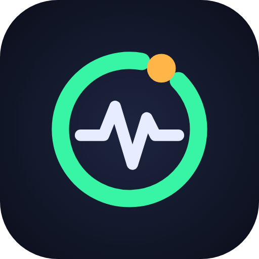
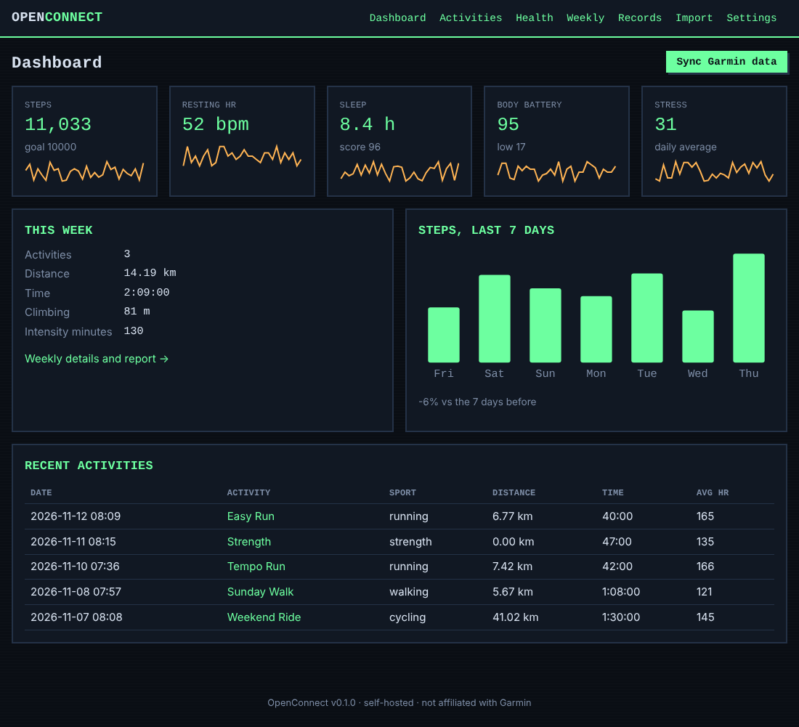
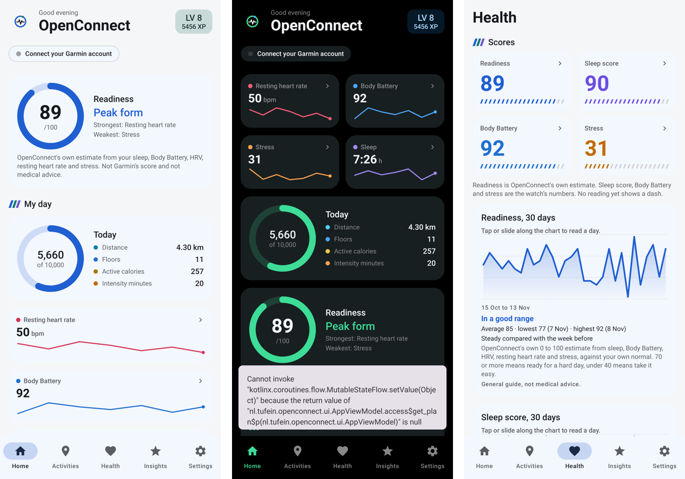
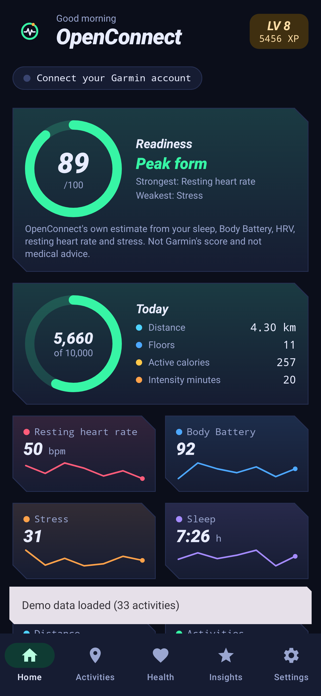
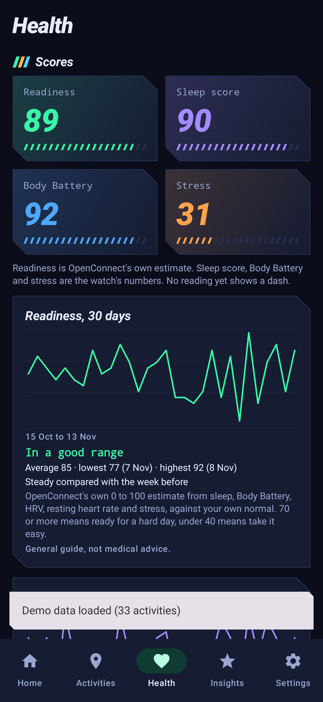
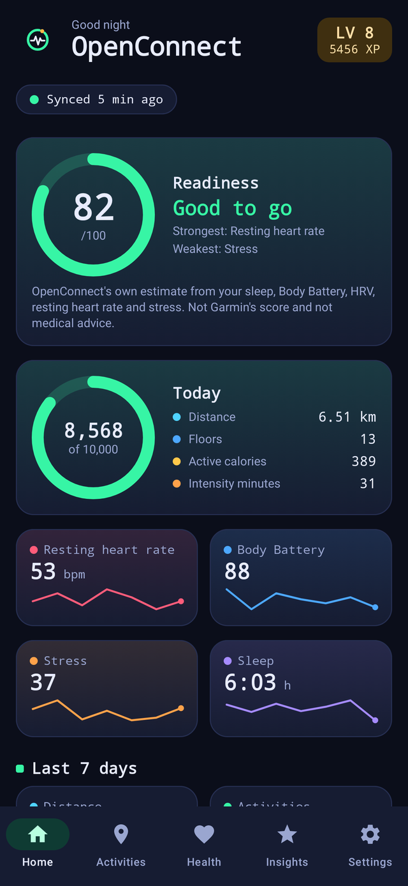
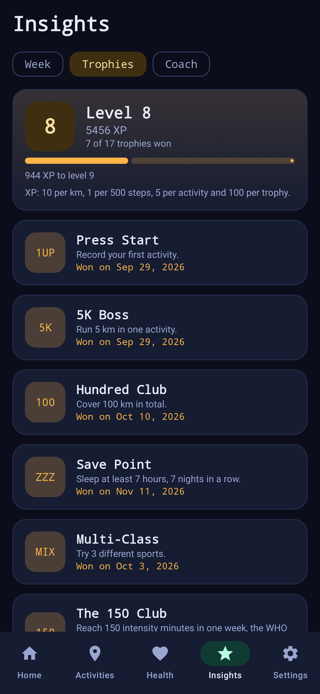
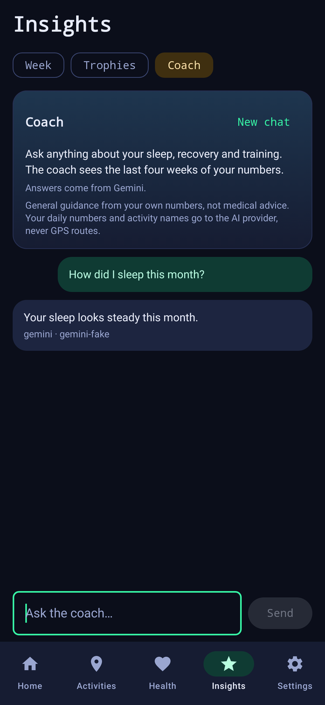

<p align="center"></p>

# OpenConnect

An open-source, **self-hosted alternative to Garmin Connect**, built on the official
[Garmin Connect Developer Program](https://developer.garmin.com/gc-developer-program/overview/) APIs
and developed test-first. Your activities and daily health data live in one SQLite file on your own
machine, with a dashboard, FIT/GPX/TCX import and export, and optional AI-written reports by Claude or Gemini.



> **Status: v0.16.0, an early foundation.** It runs end to end on demo data with no credentials.
> Live Garmin access needs Garmin Developer Program credentials (see [Garmin access](#garmin-access)).
> Not affiliated with or endorsed by Garmin.

## Android app

OpenConnect also comes as a **standalone Android app** (Android 8+), with no server needed: your data
stays on the phone, you import FIT, GPX or TCX files, and reports are written offline or by Claude with
your own API key. Download the APK from the [releases page](https://github.com/Tufein/OpenConnect/releases).
Since v0.3.0 it can also **read a Garmin watch directly**: over a USB cable (activities, steps, sleep, heart rate,
stress, Body Battery, SpO2, HRV) and over Bluetooth (live heart rate), with no server and no Garmin account. Since
v0.4.0 it can also **pull your own data from your Garmin account** with a personal key you make yourself (no approval,
no server of ours), and read a folder of watch files; Bluetooth reconnects by itself. The account route has been run
live against a real account; the USB and Bluetooth parts have not yet been tried on a real watch. See
**[docs/GARMIN.md](docs/GARMIN.md)** and **[docs/WATCH.md](docs/WATCH.md)** for what works and what is unverified.
More about the app, its limits and what has been verified: **[docs/ANDROID.md](docs/ANDROID.md)**.

**New in v0.27.0:** **heart-rate zones**: a Zones tab under Insights with your maximum heart rate (the highest measured, or set it yourself), the five zone limits, time in each zone over the last 7 days with a plain verdict (too hard, too much in the middle, all easy or a good mix), earlier weeks, and a zones card on every activity. v0.26.0: your **training plan as watch workouts**: the next 7 days of the plan are written as structured FIT workouts (warm-up, tempo or intervals with pace targets, cool-down) and copied over USB to `GARMIN/NewFiles`; not tried on a real fenix 8 yet. v0.25.0: **race predictions** (5 km, 10 km, half and full marathon from your best efforts, with Riegel's formula and an honest note on how far each one stretches) and a **race goal** with countdown, target pace and a verdict, on the Plan tab. v0.24.0: the way to the **Connect IQ store**: face, widget and glance can be set up in Garmin's Connect IQ app, `watch/build.sh --package` makes the `.iq` file, `watch/check-store.sh` checks it, the store texts are written (English and Dutch) and *Settings* can link to the store listing once it exists (see **[docs/CONNECT_IQ_STORE.md](docs/CONNECT_IQ_STORE.md)**). v0.23.0: a **glance and widget** for the watch as Connect IQ source (`build.sh --type widget`, not compiled yet) and a copy button in the app. v0.22.0: choose your fenix 8 model in the preview and get the exact file name and build command; `build.sh --all-colors` builds one face per colour. v0.21.0: the **watch faces** as Connect IQ source in `watch/` (Clean, Dashboard, Retro) with a build script; see **[docs/WATCH_FACES.md](docs/WATCH_FACES.md)**. They are not compiled yet. v0.20.0: a round **watch face preview** in *Settings* (Clean, Dashboard or Retro, five colours, four fields) with your own numbers. v0.19.0 added three designs: **three designs** to choose from under *Settings, Appearance, Design*: **Clean Pro** (calm cards,
a big readiness ring and a "My day" list), **Dashboard Dark** (tiles in two columns on black, bold bars) and **Retro
Pro** (the arcade look). A new install asks at the first start. v0.18.0 added seven colour themes, three styles and
watch faces over USB. The plan for what comes next is in **[docs/ROADMAP.md](docs/ROADMAP.md)**; see the
[release notes](docs/releases/v0.27.0.md).

<p></p>


**v0.8.0:** a **Scores** section on Health with four race-HUD tiles (readiness, sleep score, Body Battery, stress),
30-day charts for readiness and the watch's sleep score with the same plain-language explanation, and a new **sporty look**:
angular cut-corner cards, forward-leaning headlines, speed stripes and segmented score bars. See the
[release notes](docs/releases/v0.8.0.md).

<p>


</p>

**v0.7.0:** every health chart now **says what it shows**: the period, the average with the best and worst day,
how the last week compares with the week before, whether that is in a common range, and what the number means. The app
also explains how to use it **next to Garmin Connect** and keeps a run once when it arrives from both the watch and your
Garmin account. See the [release notes](docs/releases/v0.7.0.md).

**v0.6.0:** **sync a Garmin watch straight over Bluetooth**, no cable, no account, no Garmin Connect: the app
pairs with the watch and downloads activities, steps, sleep, heart rate, stress and HRV files using Garmin's own protocol,
ported from Gadgetbridge. Written for the fenix 8 and other recent watches, **not yet tried on a real watch**. The project
is now AGPL-3.0. See **[docs/BLUETOOTH.md](docs/BLUETOOTH.md)** and the [release notes](docs/releases/v0.6.0.md).

**v0.5.0:** a new look and logo; sync that runs like Garmin Connect (when the app opens, in the background about
every 3 hours, pull to refresh, and a status pill that says when it last synced); **Gemini next to Claude**, each with
your own key entered in the app, for the reports and for a new **Coach** chat about your numbers; a readiness score, 17
trophies with a level, activity search and sorting, and CSV export. See **[docs/AI.md](docs/AI.md)**,
**[docs/INSIGHTS.md](docs/INSIGHTS.md)** and the [release notes](docs/releases/v0.5.0.md).

<p>



</p>

*Rendered on a computer by the app's own UI tests, not captured on a phone.*

## What is in the box

| Area (server) | v0.1.0 |
|------|--------|
| **Activities** | List and detail, GPS route map, HR and elevation charts, kilometre splits, personal records |
| **Daily health** | Steps, intensity minutes, resting HR, sleep stages and score, stress, Body Battery |
| **Dashboard** | Today's cards with 30-day sparklines, weekly report with totals by sport and previous-week comparison |
| **Files** | Import and export **FIT, GPX and TCX** (CRC-checked FIT, safe XML parsing, idempotent re-import) |
| **AI reports** | Per activity and per week, written by Claude or Gemini, or by an offline template when no key is set |
| **Achievements** | Local badges ("Player One", "Seven-Day Streak", "Everest Climber", …) computed from your data |
| **Garmin** | OAuth 2.0 + PKCE, pull sync, push webhook, backfill client, and an offline fake Garmin for demos and tests |
| **Interfaces** | Web UI, JSON API with OpenAPI docs (`/api/docs`), CLI |

The full inventory of Garmin Connect functions, which ones the Developer API exposes, and what is
planned is in **[docs/FEATURES.md](docs/FEATURES.md)**. How it is built is in
**[docs/ARCHITECTURE.md](docs/ARCHITECTURE.md)**.

## Quick start

Requires Python 3.11 or newer.

```bash
git clone https://github.com/Tufein/OpenConnect.git
cd OpenConnect
python -m venv .venv && . .venv/bin/activate
pip install -e ".[dev]"

openconnect sync --days 60     # loads demo data (mock mode is the default)
openconnect serve              # http://127.0.0.1:8000
```

Or with Docker (published on localhost only; OpenConnect has no login, see [Security](#security)):

```bash
docker compose up --build
```

### Command line

```bash
openconnect sync [--days N]                    # pull from Garmin (or the demo source)
openconnect activities [--limit N]             # list stored activities with their ids
openconnect export ID --format fit|gpx|tcx [-o FILE]
openconnect import run.fit ride.gpx ...        # FIT, GPX or TCX
openconnect report weekly [--week YYYY-MM-DD]  # AI (or template) report
openconnect report activity ID [--force]
openconnect serve [--host H] [--port P]
```

## Configuration

Everything is optional; see [`.env.example`](.env.example). Settings come from environment variables.

| Variable | Default | Purpose |
|----------|---------|---------|
| `OPENCONNECT_DB` | `data/openconnect.db` | SQLite file |
| `OPENCONNECT_HOST` / `OPENCONNECT_PORT` | `127.0.0.1` / `8000` | Listen address |
| `OPENCONNECT_BASE_URL` | `http://localhost:8000` | Public URL (OAuth redirect URI, Host allow-list) |
| `OPENCONNECT_ALLOWED_HOSTS` | | Extra accepted `Host` names, comma separated |
| `OPENCONNECT_GARMIN_MODE` | `mock` | `mock` (offline demo data) or `live` |
| `GARMIN_CLIENT_ID` / `GARMIN_CLIENT_SECRET` | | Required in `live` mode |
| `OPENCONNECT_WEBHOOK_TOKEN` | | Shared secret for `POST /api/garmin/webhook?token=…` |
| `OPENCONNECT_AI_PROVIDER` | `auto` | `auto`, `anthropic` or `template` |
| `ANTHROPIC_API_KEY` | | Enables Claude-written reports in `auto` mode |
| `OPENCONNECT_AI_MODEL` / `OPENCONNECT_AI_EFFORT` | `claude-opus-5-5` / `medium` | Model and effort for reports |
| `OPENCONNECT_LANGUAGE` | `en` | Report language (`en`, `nl`; Claude supports more) |

## Garmin access

Garmin's data APIs are not open to everyone. In short (details and sources in
[docs/FEATURES.md](docs/FEATURES.md)):

* **Personal API**: your own data, pull only, key created on the Garmin Connect website.
  *Support is the first roadmap item.*
* **Starter / Enterprise** (business tiers): OAuth 2.0 with PKCE. Starter is push only, so register
  `https://<your-host>/api/garmin/webhook?token=<secret>` with Garmin. **This is what live mode
  implements today.**
* Register `<base-url>/api/garmin/callback` as the redirect URI, set
  `OPENCONNECT_GARMIN_MODE=live`, then use *Settings → Connect to Garmin*.

The Garmin endpoints and field names were taken from Garmin's public documentation and a few
third-party references because the full specification sits behind the developer portal login. They
are configurable and marked **verify** in the docs until they have been exercised against real
credentials.

## AI reports and privacy

Press *Generate report* on an activity or a week. OpenConnect builds a small structured summary
(distance, pace, splits, HR trend, weekly totals, comparison with previous data) and sends **only
that** to the model. Free text such as activity names travels inside a JSON data block that the
system prompt marks as data, not instructions. Reports are cached by a hash of their inputs, so
unchanged data never costs a second call. Without `ANTHROPIC_API_KEY` the built-in offline template
is used and nothing leaves your machine.

Check Garmin's Developer Program Agreement before sending Garmin-derived data to any third party.

## Security

OpenConnect v0.1.0 has **no login**. Keep it on `localhost` or a trusted network, or put a reverse
proxy with authentication in front of it. Built in: loopback bind by default, `Host` allow-list,
refusal of cross-origin POSTs, strict Content-Security-Policy, size-limited and validated uploads,
XXE-safe XML parsing, and an optional webhook secret. OAuth tokens are stored in the SQLite file in
plain text, so protect that file. More in [docs/ARCHITECTURE.md](docs/ARCHITECTURE.md).

## Development

The project is developed test first: each layer's tests were written before its code, and nothing
in the suite needs the network, a Garmin account or an API key.

```bash
pytest                                  # unit + integration tests
pytest --cov=openconnect                # with coverage
ruff check src tests && ruff format --check src tests
```

```
src/openconnect/
  domain.py        models and pure helpers
  garmin/          OAuth/PKCE, HTTP source, mapper, ingest, offline fake
  formats/         FIT, GPX, TCX
  services/        sync, dashboard, records, achievements
  ai/              facts, prompts, providers (Claude + template), report service
  web/             FastAPI app, JSON API, HTML UI, SVG charts
  storage/         SQLite repository
  cli.py           command line
tests/             unit/ and integration/
```

CI (GitHub Actions) runs lint, format check and the tests on Python 3.11 to 3.13, builds and
smoke-tests the wheel, and builds the Docker image. A second workflow tests, lints and builds the Android
app. A release (pushing a `v*` tag, or running the Release workflow on `main`) builds the APK, the wheel
and the sdist and publishes them together.

The Android project lives in `android/` (`core/` is plain Kotlin, `app/` is the Compose app); see
[docs/ANDROID.md](docs/ANDROID.md) for how to build and test it.

## Roadmap

Trying the watch routes on real devices, Health Connect as a source, Garmin Personal API sync in the Android app, Personal API support in the server, the rest of the Health API data types (HRV, Pulse Ox, respiration, body
composition, …), laps and interactive charts, Ping/Pull callbacks and backfill UI, Training and
Courses API publishing, monthly reports, and optional authentication. See
[docs/FEATURES.md](docs/FEATURES.md#7-roadmap).

## License

[AGPL-3.0-or-later](LICENSE) since v0.6.0 (MIT up to v0.5.0). The Garmin Bluetooth sync is ported from
[Gadgetbridge](https://codeberg.org/Freeyourgadget/Gadgetbridge) (AGPL-3.0), see [NOTICE](NOTICE).
Garmin and Garmin Connect are trademarks of Garmin Ltd.
