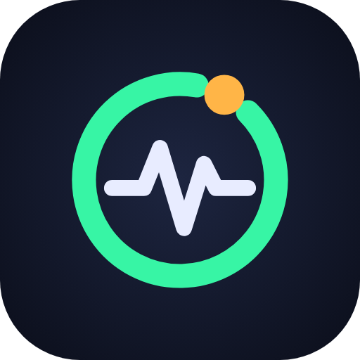

<p align="center"></p>

# OpenConnect

An open-source, **private alternative to Garmin Connect**: an Android app (and a self-hosted server) that keeps your
activities and daily health data on your own device, with charts, insights, a coach and reports, optionally written by
an AI with your own key. It reads a Garmin watch directly, your Garmin account with a key you make yourself, an Oura
Ring, a WHOOP band, a Hume Band (via Health Connect) and FIT, GPX and TCX files. Built test-first, AGPL-3.0.

> **Status: v1.8.0.** The Watch screen now shows the **charge of the watch and the Oura Ring** with when each last
> reported, and the workout builder takes a **distance with a pace** (for example 6 × 1 km at 5:00–5:30 per km) and can
> **edit** a workout afterwards instead of only adding and deleting. The three widget sizes of v1.7.0, the workout
> builder of v1.6.0, the manual activity of v1.5.0, the archive import of v1.3.0 and the names from your export in
> v1.4.0 stay.
> [Release notes](docs/releases/v1.8.0.md).
> It runs end to end on demo data with no account. **Only the Garmin account route has been tried live; nothing else has been tried on a real phone, watch, ring
> or band yet** (see [what is tested](#what-is-tested)). The checks that remain are listed in
> [docs/PUBLIC_RELEASE.md](docs/PUBLIC_RELEASE.md); the plan is in [docs/ROADMAP.md](docs/ROADMAP.md).
> Not affiliated with or endorsed by Garmin, Oura, WHOOP or Hume.


## Install the Android app

Needs **Android 9 or newer**. No server, no account, no store: your data stays on the phone. The full guide, with checking the
download, the "install unknown apps" switch, updating and Obtainium, is [docs/INSTALL.md](docs/INSTALL.md).

1. Open the [latest release](https://github.com/Tufein/OpenConnect/releases/latest) on your phone and download
   `openconnect-vX.Y.Z.apk` (and `openconnect-vX.Y.Z.apk.sha256` if you want to check it).
2. Open the file. Android asks once to allow installing apps from your browser or file manager; allow it.
3. Open **OpenConnect**, answer the first-start questions and press **Load demo data** to look around.

Check the download with `sha256sum -c openconnect-vX.Y.Z.apk.sha256`. Every release is signed with the same key, so an
update installs over the old app and keeps your data; *Settings, Updates* can fetch and verify the next one for you.
The signing certificate is listed in [SECURITY.md](SECURITY.md). A phone with Android 8 stays on v0.51.0.

Then connect what you have, all optional: a Garmin watch, bike computer or golf device (any family, see
[docs/GARMIN_DEVICES.md](docs/GARMIN_DEVICES.md)) over USB or Bluetooth ([docs/WATCH.md](docs/WATCH.md),
[docs/BLUETOOTH.md](docs/BLUETOOTH.md)), your Garmin account with your own key ([docs/GARMIN.md](docs/GARMIN.md)), an
Oura Ring ([docs/OURA.md](docs/OURA.md)), WHOOP ([docs/WHOOP.md](docs/WHOOP.md)), a Hume Band
([docs/HUME.md](docs/HUME.md)), Claude or Gemini for reports and the coach ([docs/AI.md](docs/AI.md)). Everything about
the app, its limits and how to build it: [docs/ANDROID.md](docs/ANDROID.md).

## What it does

Today and insights per day, activities with maps, heart-rate zones and splits, form, readiness and training load,
race predictions and a season plan, sleep and heart-rate trends, shoes, a journal, a calendar and streaks, hi-scores,
a training plan that can go to the watch as FIT workouts, a coach chat, widgets and nudges, backup and CSV export, a
look of its own ([docs/DESIGN.md](docs/DESIGN.md)) in Dutch and English. The whole inventory, with what each number
means, is in [docs/INSIGHTS.md](docs/INSIGHTS.md) and [docs/FEATURES.md](docs/FEATURES.md); every release's story is in
the [changelog](CHANGELOG.md).

## What is tested

Everything has automated tests that run without a network, an account or a key (more than 970 of them). **Real
hardware is another matter.** The register of what has and has not been checked is in
[docs/ROADMAP.md](docs/ROADMAP.md#7-wat-nog-niet-is-gecontroleerd-register):

| Source | State |
|--------|-------|
| Garmin account with your own key (daily data, sleep, HRV, SpO2, Body Battery) | tried once against a real account |
| Garmin watch over USB, over Bluetooth, live heart rate with the screen off, workouts to the watch | **not tried on a real watch or phone** |
| Health Connect, Hume Band | **not tried on a real phone or band** |
| Oura Ring, WHOOP | **never run against the real service** |
| Claude and Gemini | **no live calls with a real key** |
| In-app updater, key vault, app lock | **not tried on a real phone** |

Release notes say what was not checked, every time.

## Privacy

The Android app has no server of ours and sends nothing anywhere you did not switch on. If you add an AI key, a short
JSON summary of your numbers and activity names (never the GPS track) goes to that provider for a report or the coach;
keys are kept in the Android Keystore. *Settings, About and licences* in the app lists every licence and says, per source,
whether it was ever tried on a real device and lists every address the app can send data to; *Share diagnostics* shows the
exact report (no keys, tokens, names, health values or routes) before anything is shared. The full statement, in English and
Dutch, is [docs/PRIVACY.md](docs/PRIVACY.md); a test fails when the code mentions an address that is not in it. More in
[docs/ANDROID.md](docs/ANDROID.md) and [SECURITY.md](SECURITY.md).

## The server (self-hosted)

The Python server is the original OpenConnect: FastAPI, one SQLite file, a web dashboard, a JSON API
(`/api/docs`) and a CLI. Requires Python 3.11 or newer.

```bash
git clone https://github.com/Tufein/OpenConnect.git
cd OpenConnect
python -m venv .venv && . .venv/bin/activate
pip install -e ".[dev]"

openconnect sync --days 60     # loads demo data (mock mode is the default)
openconnect serve              # http://127.0.0.1:8000
```

Or `docker compose up --build` (published on localhost only; set `OPENCONNECT_PASSWORD` before exposing it, see
[SECURITY.md](SECURITY.md)).

```bash
openconnect sync [--days N]                    # pull from Garmin (or the demo source)
openconnect activities [--limit N]             # list stored activities with their ids
openconnect export ID --format fit|gpx|tcx [-o FILE]
openconnect import run.fit ride.gpx ...        # FIT, GPX or TCX
openconnect report weekly [--week YYYY-MM-DD]  # AI (or template) report
openconnect report activity ID [--force]
openconnect serve [--host H] [--port P]
```

Settings come from environment variables, all optional (see [`.env.example`](.env.example)):

| Variable | Default | Purpose |
|----------|---------|---------|
| `OPENCONNECT_DB` | `data/openconnect.db` | SQLite file |
| `OPENCONNECT_HOST` / `OPENCONNECT_PORT` | `127.0.0.1` / `8000` | Listen address |
| `OPENCONNECT_BASE_URL` | `http://localhost:8000` | Public URL (OAuth redirect URI, Host allow-list) |
| `OPENCONNECT_ALLOWED_HOSTS` | | Extra accepted `Host` names, comma separated |
| `OPENCONNECT_GARMIN_MODE` | `mock` | `mock` (offline demo data), `personal` (your own key) or `live` (Developer API) |
| `GARMIN_PERSONAL_KEY` | | Required in `personal` mode; create it on the Garmin Connect website |
| `GARMIN_CLIENT_ID` / `GARMIN_CLIENT_SECRET` | | Required in `live` mode |
| `OPENCONNECT_WEBHOOK_TOKEN` | | Shared secret for `POST /api/garmin/webhook?token=…` |
| `OPENCONNECT_CALLBACK_HOSTS` | `apis.garmin.com` | HTTPS hosts allowed for Ping/Pull callbacks |
| `OPENCONNECT_PASSWORD` | | Enables sign-in with a signed seven-day cookie |
| `OPENCONNECT_AI_PROVIDER` | `auto` | `auto`, `anthropic` or `template` |
| `ANTHROPIC_API_KEY` | | Enables Claude-written reports in `auto` mode |
| `OPENCONNECT_AI_MODEL` / `OPENCONNECT_AI_EFFORT` | `claude-opus-5-5` / `medium` | Model and effort for reports |
| `OPENCONNECT_LANGUAGE` | `en` | Report language (`en`, `nl`; Claude supports more) |

### Garmin access

Garmin's data APIs are not open to everyone. The **personal key** route (your own data, pull only, key made on the
Garmin Connect website, no developer agreement) works in the app and the server
(`OPENCONNECT_GARMIN_MODE=personal`). The business tiers (Starter, Enterprise: OAuth 2.0 with PKCE, push or pull) are
what `live` mode implements, and need Garmin's approval. Endpoints and field names come from Garmin's public
documentation and are marked **verify** until exercised with real credentials; details in
[docs/GARMIN.md](docs/GARMIN.md) and [docs/FEATURES.md](docs/FEATURES.md). Check Garmin's Developer Program Agreement
before sending Garmin-derived data to any third party.

## Development

The project is developed test first: each layer's tests were written before its code, and nothing in the suite needs
the network, a Garmin account or an API key.

```bash
pytest                                  # Python unit + integration tests
ruff check src tests && ruff format --check src tests
cd android && ./gradlew :core:test :app:testDebugUnitTest :app:lintDebug   # the Android app
python tools/changelog.py               # after adding docs/releases/vX.Y.Z.md
```

```
src/openconnect/   the Python server: domain, garmin/, formats/, services/, ai/, web/, storage/, cli.py
android/core/      the app's pure Kotlin logic (JUnit)
android/app/       the Jetpack Compose app (Robolectric UI tests)
watch/             Connect IQ source for watch faces (never compiled)
docs/              guides, design, roadmap, release notes
```

CI (GitHub Actions) tests the server on Python 3.11 to 3.13, builds the wheel and the Docker image, and tests, lints and
builds the Android app, and starts the shrunk APK on an Android emulator and walks through it. A release is the *Release*
workflow run on `main`: it tests everything again, signs the APK, starts the signed APK on an emulator and only then
publishes it with the wheel. Versions mean what [docs/VERSIONING.md](docs/VERSIONING.md) says. See
[CONTRIBUTING.md](CONTRIBUTING.md).

## License

[AGPL-3.0-or-later](LICENSE) since v0.6.0 (MIT up to v0.5.0). The Garmin Bluetooth sync is ported from
[Gadgetbridge](https://codeberg.org/Freeyourgadget/Gadgetbridge) (AGPL-3.0), see [NOTICE](NOTICE).
Garmin and Garmin Connect are trademarks of Garmin Ltd.

## Documentation

[Changelog](CHANGELOG.md) · [Roadmap](docs/ROADMAP.md) · [Release checklist](docs/PUBLIC_RELEASE.md) ·
[Install](docs/INSTALL.md) · [Privacy](docs/PRIVACY.md) · [Performance](docs/PERFORMANCE.md) ·
[Versioning](docs/VERSIONING.md) · [Security](SECURITY.md) · [Contributing](CONTRIBUTING.md) ·
[Release notes](docs/releases)
