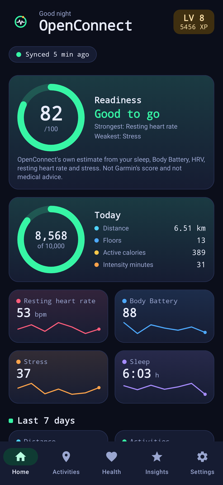

# OpenConnect for Android

A standalone Android app (`android/`). It needs **no server**: storage, FIT/GPX/TCX handling, the
dashboard and the reports all run on the phone, and your data stays in the app's private storage.
The Python server from v0.1.0 is unchanged and stays available for people who prefer to self-host.



*These images are rendered on a computer by the app's own UI tests (Robolectric), not captured on a
phone, so fonts and spacing on a real device can differ slightly.*

## What the app does (v0.5.0)

| Screen | Contents |
|--------|----------|
| **Home** | A greeting, your level and a **sync status pill** ("Synced 5 min ago"); a **readiness** ring; today's steps ring with distance, floors, calories and intensity minutes; resting heart rate, Body Battery, stress and sleep tiles with 7-day lines; last 7 days; 30-day steps chart; recent activities. Pull down to sync |
| **Activities** | List with **search** (name, sport, date) and **sorting**, a sport filter and an import button; detail with route map, heart-rate and elevation charts, kilometre splits, AI report, export as FIT, GPX or TCX, delete |
| **Health** | Steps, sleep, resting heart rate, Body Battery, HRV, blood oxygen and respiration trends, one colour per signal |
| **Insights** | **Week** (totals, AI report, personal records), **Day** (one day against your own last four weeks, from the watch or the ring, chosen in dropdowns), **Trophies** (17 trophies and a level) and **Coach** (chat about your numbers). See [INSIGHTS.md](INSIGHTS.md) and [AI.md](AI.md) |
| **Watch** | Read a Garmin watch over a USB cable or a folder of watch files (activities, steps, sleep, heart rate, stress, Body Battery, SpO2, HRV, ...) and follow live heart rate over Bluetooth, which reconnects by itself. See [WATCH.md](WATCH.md) |
| **Garmin account** | Paste your personal Garmin key and pull steps, heart rate, stress, Body Battery, sleep, HRV and activities (with their original FIT files) from your Garmin account; syncs by itself too. See [GARMIN.md](GARMIN.md) |
| **Settings** | Theme (follow phone, dark, light), import files, load or delete all data, **CSV export**, who writes the reports and the coach (automatic, offline, Claude, Gemini), report language, a key and model per provider, and an **updater** that checks GitHub, verifies the APK's SHA-256 and installs it |

English and Dutch. Since v1.0.0 the look is modern by default (see [DESIGN.md](DESIGN.md)): IBM Plex Sans type, generously rounded cards with a soft lift, pill controls, smooth charts and a floating tab bar, on warm paper (light) or warm black (dark) with orange as the one signal colour and one colour per body signal. The original "Handheld" console look — pixel type, pixel-cut corners, flat panels with a hard shadow, block charts and a 25-block readiness bar — is still available as the Retro style, as is a formal Classic style. All 24 colour themes (retro screens, easy-on-the-eyes ones such as High contrast, colourful ones and the phone's Wallpaper) work in every style; Retro also has a choice of letters, and the launcher icon is one of eight. The launcher icon is the pixel heart of the logo with a pulse through it, and it has a themed (single-colour) version for Android 13 and later.

### Where the data comes from

1. **Demo data**: about 45 days of Garmin-like activities, sleep and daily health, generated on the phone.
2. **File import**: pick FIT, GPX or TCX files from the phone, or share or open a file with OpenConnect.
   Importing the same file again does not create a duplicate (the activity id is derived from the content).
3. **A Garmin watch, directly** (new in v0.3.0): USB cable for everything the watch stores, Bluetooth for live
   heart rate. No server and no Garmin account. How it works and what is not tested yet: **[WATCH.md](WATCH.md)**.
4. **Your Garmin account** (new in v0.4.0): with a personal key that you make yourself, no server in between. **[GARMIN.md](GARMIN.md)**.

### AI reports, the coach and privacy

- By default reports are written **offline by rules**; nothing leaves the phone, and the coach is not available.
- With your own **Claude** or **Gemini** key (Settings), reports and the coach are written by that AI. The request
  carries a short JSON summary of the numbers and the activity names, **never the GPS track**. Keys are kept in
  `EncryptedSharedPreferences` (Android Keystore), only ever entered in the app, sent only to their own provider and
  never in a web address. If secure storage is unavailable a key is not stored at all. Details: **[AI.md](AI.md)**.
- Permissions: `INTERNET` is used for Garmin and for the AI calls. The Bluetooth permissions (Android 12 and newer: scan,
  flagged as not used for location, and connect) are only used for the live heart rate sensor, and USB access is asked by
  Android when you plug a watch in. Since v0.5.0 the background sync adds four permissions through WorkManager:
  `ACCESS_NETWORK_STATE` and `WAKE_LOCK` (to run when there is a connection), `RECEIVE_BOOT_COMPLETED` (to schedule
  again after a restart) and `FOREGROUND_SERVICE` (declared by the library, not used by the app). Backups and device
  transfer are off (`allowBackup=false` plus data-extraction rules that exclude everything).
- Text from imported files (activity names) only travels inside the data block of the prompt.

### About, source labels and diagnostics (v0.55.0)

- **Label per source.** `core/SourceLabels.kt` is the one list: every data source (16 of them) is either *Tested on a real
  device (date, version)* or *Experimental*. A test forces every source to have a label. A source only moves to tested with
  a real trial to point at, and a line in the register in [ROADMAP.md](ROADMAP.md) (section 7). The labels show under
  *Settings, Your devices*, on the first-start screen and on the About screen. Today only the Garmin account (2026-11-12,
  v0.4.0) is tested.
- **About and licences** (`ui/AboutScreen.kt`, a sub-screen of Settings): version, AGPL-3.0, link to the source, what has
  been tried on a real device, a short privacy note, every licence (`core/Licences.kt`; a test compares it with the
  libraries in the build files) and the Garmin disclaimer.
- **Share diagnostics** (`core/Diagnostics.kt`): a text with the app, Android and device versions, what is switched on, the
  stored counts, the label of every source and the last 20 sync lines. The dialog shows the exact text and only then
  offers Share. Keys, tokens, long hex or base64 strings, e-mail addresses and the query part of web addresses are
  removed; names, health values and routes are never put in. Tests feed it fake secrets in several shapes.
- The GitHub issue template *Hardware trial* asks for this report.

### Your data is safe (v0.56.0)

- **Schema migrations** are proved by `SchemaMigrationTest`: the database of every released schema (1 to 5) is rebuilt as
  that release made it, filled, and opened by the current code; nothing is lost, and the result has the same tables,
  columns and indexes as a fresh install. A last test fails when `SqliteRepository.VERSION` goes up without a new fixture.
  The only thing a migration ever deleted is the Oura Ring's workouts among the activities (schema 3).
- **Backup** (`core/Backup.kt`): the database (activities with tracks, daily, sleep, samples, the days of the Oura Ring,
  WHOOP and Hume Band) plus, since v0.56.0, `UserData`: the journal, shoes, training plan, race, maximum heart rate and
  weekly goals, which live outside the database. Restoring never deletes or overwrites: journal days are joined, shoes are
  added by id, and the plan, race, maximum heart rate and goals are only taken when this phone has none of its own. Keys,
  tokens and passwords are never in the file (a test lists the allowed top-level parts). A guard test fails when a table
  is added that is neither in the backup nor listed as left out with a reason.
- **Export everything** (`core/ExportAll.kt`): one ZIP with `daily.csv`, `activities.csv`, every activity as FIT (and GPX
  when it has a position), the backup file and a `README.txt`. The FIT and GPX files are written from what the app stored,
  because the watch's original files are not kept.
- **The updater** refuses a release without a checksum file, a download that does not match it, and an APK signed with
  another key than the installed app (`updates/ApkSigners.kt`).

### Accessible and bilingual (v0.57.0)

- **`AccessibilityAuditTest`** walks Home, Activities, Health, Insights, Settings, About and an activity, with demo data, in
  three set-ups (a normal phone, letters at 200 percent, a tablet width), scrolling each list, and fails on: a tappable
  thing with no label for a screen reader, a tappable thing under 48 by 48 dp, and text cut off at the bottom. It found and
  fixed: switches that had no label of their own (`SwitchRow` now makes the whole row one switch, with the words as its
  label), buttons and tiles under 48 dp, and an unlabelled text field.
- **Charts are read as words:** each chart's description is its name plus how many values it has and the lowest, highest
  and latest (`core/ChartSummary.kt`).
- **Wide screens:** the screens stop at a reading width of 640 dp in the middle, instead of stretching across a tablet.
- **`LanguageParityTest`:** every text exists in Dutch and English with the same placeholders, plurals and list lengths, and
  no long Dutch text is identical to the English one.
- Not done by a test: a real TalkBack run on a phone, reading order, and focus order (step T14 in PUBLIC_RELEASE.md).

## How it is built

```
android/
  core/   pure Kotlin/JVM, no Android dependency, JUnit tests
    Domain, Repository (+ in-memory and track codec), Stats, Demo
    formats/  FIT (encoder + decoder + CRC + generic reader), GPX, TCX, safe XML parsing
    watch/    watch FIT files -> readings, daily aggregation, sync, MTP folder logic, Bluetooth heart rate parser
    reports/  facts, prompts, template + Claude + Gemini providers, coach, cached ReportService
    Readiness, Achievements, ActivityQuery, Csv   (v0.5.0)
  app/    Jetpack Compose UI, SQLite storage, settings, view model
    ai/       AiController (keys and providers) and CoachController
    sync/     the WorkManager job that syncs Garmin in the background
    garmin/   the Garmin account controller and the sync status badge
    watch/    USB (MtpDevice) and Bluetooth (GATT) links, and the controller behind the Watch screen
```

- **Core ported from the server.** The Kotlin FIT, GPX and TCX exporters produce files that are
  byte-identical to the Python server's (checked against fixtures the server generated), and the Kotlin
  importer reads the server's files back to the same activity.
- **Storage.** SQLite. Tracks are stored compressed, one blob per activity, and list queries never load
  them. Since v0.3.0 (database version 2) there are also tables for the watch's readings and for the watch
  files that were already read; an update from v0.2.0 migrates in place and keeps your data.
- **Safe parsing.** XML with a DOCTYPE or ENTITY is refused (no XXE), FIT files are CRC-checked, and
  imports are capped at 25 MB per file.
- **Reports.** `ReportService` caches a report by a hash of the input facts, language, provider and
  model, so unchanged data is not regenerated or billed twice.

## Build it

Requirements: JDK 17 or newer and the Android SDK (platform 35, build-tools 35). Set `ANDROID_HOME`.

```bash
cd android
./gradlew :core:test                 # core unit tests
./gradlew :app:testDebugUnitTest     # app tests, incl. UI smoke tests with screenshots in app/build/screenshots
./gradlew :app:lintDebug
./gradlew :app:assembleRelease       # app/build/outputs/apk/release/app-release.apk (debug-signed unless a release key is set)
```

CI runs the same on every pull request and attaches a debug-signed APK. Release builds attach the APK, signed
with the release key, to the GitHub release (`openconnect-vX.Y.Z.apk` with a `.sha256`).

## Install it (sideload)

1. Download `openconnect-vX.Y.Z.apk` from the [releases page](https://github.com/Tufein/OpenConnect/releases).
2. On the phone, allow installing from the browser or file manager when Android asks.
3. Open the APK. Needs Android 9 or newer (v0.52.0 raised the minimum from Android 8.0; a phone with Android 8 stays on v0.51.0).

### About the signing key

Android only installs an update over an existing app when both APKs are signed with the same key, so the
release key matters: lose it and everyone has to uninstall (losing their local data) before updating.
The key is **not in this repository**.

- The first release creates the key inside GitHub Actions (`android/scripts/signing-key.sh`), so nobody
  ever has to see or paste it. It is kept in a **private draft release** named "Signing key (private, never
  publish)". Draft releases and their assets are visible only to people with write access to the repository.
  Later releases reuse it, and `verify-apk-signer.sh` checks that every released APK really is signed with it.
- If the key is ever missing but an APK was released before, the release stops instead of silently making a
  new key (set `ALLOW_NEW_SIGNING_KEY=true` to accept that on purpose).
- **Back it up.** Open the draft release (Releases, then "Drafts"), download `openconnect-release.p12` and
  save it with the `password=` line from the release text somewhere safe. Never publish that draft.
- **Better home (recommended when convenient):** GitHub secrets. Add `OPENCONNECT_KEYSTORE_BASE64` (the
  `.p12` as base64) and `OPENCONNECT_KEYSTORE_PASSWORD`; the release workflow prefers them over the draft
  release. Then delete the draft. Alias is `openconnect` and the key password equals the store password.
- Local builds and pull-request CI have no release key and sign with the throw-away Android debug key. Those
  APKs are fine for trying out but are not releases, and cannot be updated by a release APK.
- Using another key, for example for a Play Store build: set `OPENCONNECT_KEYSTORE` (path),
  `OPENCONNECT_KEYSTORE_PASSWORD` and optionally `OPENCONNECT_KEY_ALIAS` in the build environment.

## Garmin

The app cannot reuse the server's Garmin integration: Garmin's business-tier APIs push data to a server
endpoint and use a client secret, which cannot live inside an APK. What fits a standalone app is Garmin's
**Personal API** (your own data, your own key, pulled by the app, no approval needed), and that is what the
**Garmin account** screen uses since v0.4.0. The key is entered by the person using the app and kept encrypted on the
phone; it is never part of the APK. Besides that there is the **Watch screen** (USB cable, a folder of watch files,
live heart rate over Bluetooth), file import, Garmin Connect's own export, or any app that writes FIT, GPX or TCX.
Garmin's Health SDK would read the watch over Bluetooth but is limited to approved enterprise partners. Reading from
Android Health Connect is a candidate extra source (it needs Garmin Connect on the phone to fill it). All of it, with
what is verified, is in [GARMIN.md](GARMIN.md) and [WATCH.md](WATCH.md).

## What has and has not been verified

| Verified by automated tests | Not verified (needs a real phone or credentials) |
|-----------------------------|--------------------------------------------------|
| Core logic, formats, reports, both AI providers, the coach, readiness, trophies, the watch readers and the Garmin account client (the `core` tests) | Behaviour on real devices and Android versions other than the emulated API 34 |
| SQLite storage on the JVM (Robolectric), including the upgrade from v0.2.0 | File pickers, share and open-with intents, the save dialog |
| The real app driven through every tab: demo data, activity detail, offline reports, English dark and Dutch light, the Watch screen with a fake USB link, folder and Bluetooth sensor, the Garmin screen with a fake Garmin, and the v0.5.0 screens (keys, coach, trophies, readiness, sync pill, search, theme) with a fake AI (the `app` tests) | Android Keystore encryption of the API key (the JVM tests have no Keystore) |
| Watch FIT files written by Garmin's own encoder: steps, distance, calories, heart rate, stress, Body Battery, SpO2, respiration, HRV, sleep stages | **Live Claude and Gemini calls** (no key was available) and how the background job behaves on a real phone (timing is decided by Android) |
| The release APK builds, is not debuggable, and is signed with the release key from v0.2.0 on | **USB permission and `MtpDevice` on a real phone, and real Garmin files** (only synthetic files so far) |
| Lint has no errors | **Bluetooth scan and connection to a real watch or strap**, the folder picker on a phone |
| The Garmin account sync ran live against a real account on 2026-11-12 (token, all data types, one activity download) | Other accounts and watch models, the key's storage in Android Keystore |

## Roadmap

Trying the watch routes and the background job on real devices and fixing what that turns up, a live Claude and Gemini
check with real keys, the watch's `Metrics` folder (VO2 max, training status),
Health Connect as a source, a home-screen widget, laps and zoomable charts, and a signed Play Store build.
