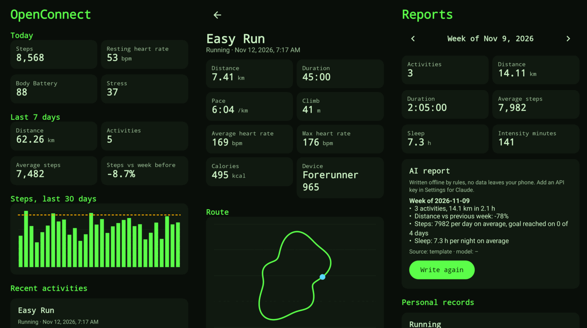

# OpenConnect for Android

A standalone Android app (`android/`). It needs **no server**: storage, FIT/GPX/TCX handling, the
dashboard and the reports all run on the phone, and your data stays in the app's private storage.
The Python server from v0.1.0 is unchanged and stays available for people who prefer to self-host.



*These images are rendered on a computer by the app's own UI tests (Robolectric), not captured on a
phone, so fonts and spacing on a real device can differ slightly.*

## What the app does (v0.3.0)

| Screen | Contents |
|--------|----------|
| **Home** | Today's steps, resting heart rate, Body Battery and stress; last 7 days; 30-day steps chart; recent activities; a card that opens the Watch screen |
| **Activities** | List with a sport filter, import button; detail with route map, heart-rate and elevation charts, kilometre splits, AI report, export as FIT, GPX or TCX, delete |
| **Health** | Steps, sleep, resting heart rate, Body Battery, HRV, blood oxygen and respiration trends |
| **Watch** | Read a Garmin watch over a USB cable (activities, steps, sleep, heart rate, stress, Body Battery, SpO2, HRV, ...) and follow live heart rate over Bluetooth. See [WATCH.md](WATCH.md) |
| **Reports** | Week picker with totals, an AI report for the week, personal records per sport |
| **Settings** | Import files, load or delete all data, report provider (automatic, offline, Claude), report language, API key, model |

English and Dutch, a phosphor-green dark theme and a light theme that follows the system setting.

### Where the data comes from

1. **Demo data**: about 45 days of Garmin-like activities, sleep and daily health, generated on the phone.
2. **File import**: pick FIT, GPX or TCX files from the phone, or share or open a file with OpenConnect.
   Importing the same file again does not create a duplicate (the activity id is derived from the content).
3. **A Garmin watch, directly** (new in v0.3.0): USB cable for everything the watch stores, Bluetooth for live
   heart rate. No server and no Garmin account. How it works and what is not tested yet: **[WATCH.md](WATCH.md)**.
4. **Garmin account sync: not implemented yet.** See [Garmin](#garmin) below.

### AI reports and privacy

- By default reports are written **offline by rules**; nothing leaves the phone.
- With your own Anthropic API key (Settings), reports are written by Claude (`claude-opus-5-5` by
  default, the model name is editable). The request carries a short JSON summary of the numbers and
  the activity name, **never the GPS track**. The key is kept in `EncryptedSharedPreferences`
  (Android Keystore). If secure storage is unavailable the key is not stored at all.
- `INTERNET` is only used for that one call. The Bluetooth permissions (Android 12 and newer: scan, flagged as
  not used for location, and connect) are only used for the live heart rate sensor, and USB access is asked
  by Android when you plug a watch in. Backups and device transfer are off
  (`allowBackup=false` plus data-extraction rules that exclude everything).
- Text from imported files (activity names) only travels inside the data block of the prompt.

## How it is built

```
android/
  core/   pure Kotlin/JVM, no Android dependency, JUnit tests
    Domain, Repository (+ in-memory and track codec), Stats, Demo
    formats/  FIT (encoder + decoder + CRC + generic reader), GPX, TCX, safe XML parsing
    watch/    watch FIT files -> readings, daily aggregation, sync, MTP folder logic, Bluetooth heart rate parser
    reports/  facts, prompts, template + Anthropic providers, cached ReportService
  app/    Jetpack Compose UI, SQLite storage, settings, view model
    watch/    USB (MtpDevice) and Bluetooth (GATT) links, and the controller behind the Watch screen
```

- **Core ported from the server.** The Kotlin FIT, GPX and TCX exporters produce files that are
  byte-identical to the Python server's (checked against fixtures the server generated), and the Kotlin
  importer reads the server's files back to the same activity.
- **Storage.** SQLite. Tracks are stored compressed, one blob per activity, and list queries never load
  them. Since v0.3.0 (database version 2) there are also tables for the watch's readings and for the watch
  files that were already read; an update from v0.2.0 migrates in place and keeps your data.
- **Safe parsing.** XML with a DOCTYPE or ENTITY is refused (no XXE), FIT files are CRC-checked, and
  imports are capped at 25 MB per file.
- **Reports.** `ReportService` caches a report by a hash of the input facts, language, provider and
  model, so unchanged data is not regenerated or billed twice.

## Build it

Requirements: JDK 17 or newer and the Android SDK (platform 35, build-tools 35). Set `ANDROID_HOME`.

```bash
cd android
./gradlew :core:test                 # core unit tests
./gradlew :app:testDebugUnitTest     # app tests, incl. UI smoke tests with screenshots in app/build/screenshots
./gradlew :app:lintDebug
./gradlew :app:assembleRelease       # app/build/outputs/apk/release/app-release.apk (debug-signed unless a release key is set)
```

CI runs the same on every pull request and attaches a debug-signed APK. Release builds attach the APK, signed
with the release key, to the GitHub release (`openconnect-vX.Y.Z.apk` with a `.sha256`).

## Install it (sideload)

1. Download `openconnect-vX.Y.Z.apk` from the [releases page](https://github.com/Tufein/OpenConnect/releases).
2. On the phone, allow installing from the browser or file manager when Android asks.
3. Open the APK. Needs Android 8.0 or newer.

### About the signing key

Android only installs an update over an existing app when both APKs are signed with the same key, so the
release key matters: lose it and everyone has to uninstall (losing their local data) before updating.
The key is **not in this repository**.

- The first release creates the key inside GitHub Actions (`android/scripts/signing-key.sh`), so nobody
  ever has to see or paste it. It is kept in a **private draft release** named "Signing key (private, never
  publish)". Draft releases and their assets are visible only to people with write access to the repository.
  Later releases reuse it, and `verify-apk-signer.sh` checks that every released APK really is signed with it.
- If the key is ever missing but an APK was released before, the release stops instead of silently making a
  new key (set `ALLOW_NEW_SIGNING_KEY=true` to accept that on purpose).
- **Back it up.** Open the draft release (Releases, then "Drafts"), download `openconnect-release.p12` and
  save it with the `password=` line from the release text somewhere safe. Never publish that draft.
- **Better home (recommended when convenient):** GitHub secrets. Add `OPENCONNECT_KEYSTORE_BASE64` (the
  `.p12` as base64) and `OPENCONNECT_KEYSTORE_PASSWORD`; the release workflow prefers them over the draft
  release. Then delete the draft. Alias is `openconnect` and the key password equals the store password.
- Local builds and pull-request CI have no release key and sign with the throw-away Android debug key. Those
  APKs are fine for trying out but are not releases, and cannot be updated by a release APK.
- Using another key, for example for a Play Store build: set `OPENCONNECT_KEYSTORE` (path),
  `OPENCONNECT_KEYSTORE_PASSWORD` and optionally `OPENCONNECT_KEY_ALIAS` in the build environment.

## Garmin

The app cannot reuse the server's Garmin integration: Garmin's business-tier APIs push data to a server
endpoint and use a client secret, which cannot live inside an APK. What fits a standalone app is Garmin's
**Personal API** (your own data, your own key, pulled by the app), which needs Garmin's approval.
That is planned and **not implemented**. The way in without any Garmin account is the **Watch screen** (USB
cable, see [WATCH.md](WATCH.md)), file import, Garmin Connect's own export, or any app that writes FIT,
GPX or TCX. Garmin's Health SDK would read the watch over Bluetooth but is limited to approved enterprise
partners. Reading from Android Health Connect is a candidate extra source (it needs Garmin Connect on the
phone to fill it); it is described in WATCH.md and not built yet.

## What has and has not been verified

| Verified by automated tests | Not verified (needs a real phone or credentials) |
|-----------------------------|--------------------------------------------------|
| Core logic, formats, reports and the watch readers (109 core tests) | Behaviour on real devices and Android versions other than the emulated API 34 |
| SQLite storage on the JVM (Robolectric), including the upgrade from v0.2.0 | File pickers, share and open-with intents, the save dialog |
| The real app driven through every tab: demo data, activity detail, offline reports, English dark and Dutch light, and the Watch screen with a fake USB link and a fake Bluetooth sensor (36 app tests) | Android Keystore encryption of the API key (the JVM tests have no Keystore) |
| Watch FIT files written by Garmin's own encoder: steps, distance, calories, heart rate, stress, Body Battery, SpO2, respiration, HRV, sleep stages | Live Claude calls from the phone (no key was available) |
| The release APK builds, is not debuggable, and is signed with the release key from v0.2.0 on | **USB permission and `MtpDevice` on a real phone, and real Garmin files** (only synthetic files so far) |
| Lint is clean | **Bluetooth scan and connection to a real watch or strap**; Garmin account sync (not built) |

## Roadmap

Trying the watch routes on real devices and fixing what that turns up, the watch's `Metrics` folder (VO2 max,
training status), Health Connect as a source, Garmin Personal API pull, a home-screen widget, laps and zoomable
charts, achievements (they exist in the server but not yet in the app), and a signed Play Store build.
