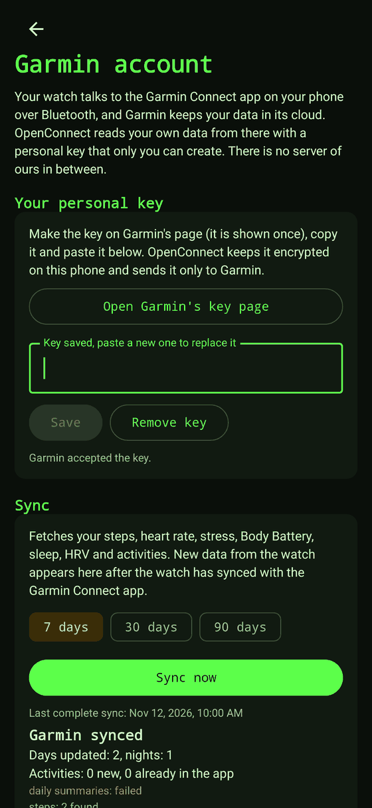

# Connecting to Garmin: Bluetooth, USB and your Garmin account

Since v0.4.0 the Android app has three ways to get your Garmin data, and they complement each other. This page
explains what Garmin allows, what the app does with each route, how it works in the code, and what has and has not
been verified.



*Rendered by the app's UI tests on a computer, with a **fake** Garmin answering. It is not a capture from a phone.*

## The short version

| Route | What it gives | Needs | Status |
|-------|---------------|-------|--------|
| **Garmin account** (Personal API) | Daily steps, heart rate, stress, Body Battery, sleep, HRV, SpO2, and your activities **with their original FIT files**, for up to a year back | A personal key you make yourself on Garmin's site, and internet. The watch must have synced with the Garmin Connect app on your phone. | **Verified live** against a real account on 2026-11-12 |
| **USB cable or a folder** | Everything the watch stores as FIT files | A cable (phone must support USB host), or a folder with the files | Core logic tested with files from Garmin's own encoder; USB, folder picker not yet tried on a phone |
| **Bluetooth** | Live heart rate and beat-to-beat HRV | A watch with *broadcast heart rate*, or a chest strap | Reconnects on its own when the sensor drops out; not yet tried on a real watch |

## Why Bluetooth alone cannot give you everything

The chain that exists in practice is:

```
watch  ⇄ (Bluetooth)  Garmin Connect app ⇄ Garmin cloud ⇄ Personal API ⇄ OpenConnect
```

What a Garmin watch exposes over Bluetooth to any other app is the standard **Heart Rate Service** and nothing
else. Everything else (steps, sleep, activities) travels over Garmin's own protocol to Garmin's own app. The
ways around that were looked at:

- **Garmin Health SDK** (Standard and Companion): reads the watch over Bluetooth, but only for approved enterprise
  partners (request form, licence, minimum order). Not available to a hobby project.
- **Connect IQ** (Garmin's watch app platform): a companion app needs a watch app written for it and Garmin Connect
  Mobile on the phone. It would also be a route through Garmin's app, only with extra steps.
- **Gadgetbridge**: reverse-engineered Garmin Bluetooth support for many watches. Since v0.6.0 its Garmin file sync is
  ported into the app (the project became AGPL-3.0 for that), see [BLUETOOTH.md](BLUETOOTH.md). Not yet tried on a real watch.
- **Health Connect**: needs the Garmin Connect app to fill it, has no Body Battery or stress, and is not real time.

So the app takes the honest combination: Bluetooth for what Bluetooth really offers (live heart rate), the cable or a
folder for raw files, and the Garmin account for everything the watch has already handed to Garmin.

## The Garmin account route

### Getting the key

1. In the app: **Garmin account** (Home or Settings) → *Open Garmin's key page*. That is
   `https://connect.garmin.com/app/settings/personalApiToken`.
2. Create a key. Garmin shows it **once**; keys expire after the period you choose (30 to 365 days) and there is one
   key at a time.
3. Copy it, paste it into the app, press *Save*. The app asks Garmin straight away whether it accepts the key.

No application and no approval are needed: this is Garmin's **Personal API**, meant for your own data in tools you run
yourself. Garmin describes it as for personal use, not for commercial apps that serve many users, so **the key is never part of the APK or the
repository**; every person makes their own.

### What the app fetches

| Data type | Garmin service | Window per request |
|-----------|----------------|--------------------|
| Daily summaries (steps, distance, floors, calories, intensity minutes, heart rate, stress, Body Battery, breathing, SpO2) | `usersummary-service/v2/dailysummaries` | 1 year |
| Steps (and the step goal) | `usersummary-service/stats/steps/daily` | 28 days |
| Stress | `usersummary-service/stats/stress/daily` | 28 days |
| HRV (last night's average) | `hrv-service/hrv/daily` | 28 days |
| Sleep (stages and score) | `sleep-service/sleep/dailySleepSummariesByDate` | 31 days |
| Body Battery | `wellness-service/wellness/bodyBattery/reports/daily` | 31 days |
| Activities and their FIT files | `activitylist-service/activities/search/activities`, `download-service/files/activity/{id}` | paged by 50 |

You choose 7, 30 or 90 days. Longer periods are cut into windows within Garmin's limits. At most 30 new
activities are downloaded per sync; syncing again continues where it stopped.

### Syncing by itself, like Garmin Connect (v0.5.0)

With a key saved, **automatic syncing is on by default** (switch it off on the Garmin screen) and covers the last 7 days:

- **When the app comes to the front**, if the last complete sync is more than a minute old, and **every 10 minutes while
  the app stays open** (since v0.16.0; it was 30 minutes before, and 6 hours in v0.4.0).
- **In the background, about every 15 minutes** (Android's shortest period for a background job; every 3 hours before v0.16.0), through Android's WorkManager, when there is a connection and the battery
  is not low. Android picks the exact moment, so it can be later in battery saver or Doze, and the job survives a restart
  of the phone. If Garmin refuses the key, the job stops until you save a new one instead of trying forever; no connection
  or a busy Garmin means a few backed-off retries and then the next round.
- **Pull down on Home** syncs right away (it opens the Garmin screen if there is no key yet).
- **The pill at the top of Home** shows the state in one line: *Synced 5 min ago*, *Syncing… 3 of 7*, *Sync failed · last good
  one 2 h ago*, *Garmin key rejected, tap to fix*, or *Connect your Garmin account*. Tapping it syncs, or opens the Garmin screen.

The data still travels watch, then Garmin Connect app, then Garmin's cloud, then OpenConnect, so a sync here only shows
what the watch has already handed to Garmin. The permissions WorkManager adds to the app are listed in
[ANDROID.md](ANDROID.md).

### How it merges with what is already there

- Counters (steps, distance, floors, minutes) keep the **larger** value, readings (resting heart rate, stress, ...) take
  the newer one, and a longer night already stored is not replaced by a shorter one. Syncing twice gives the same
  result, and data from the cable is never made smaller by the cloud.
- An activity is the same one if it starts within two minutes of one already stored, so a run that came over USB and
  through the account is not doubled. The activity file from the account is the original FIT file, so charts, splits
  and reports work exactly as for any imported file.

### What the screen tells you

After a sync each data type is listed separately: found, nothing in this period, answer not understood, or failed.
One data type failing costs only that data type. Only a refused key, no connection, a rate limit or a server error end
the sync early. When an answer was not understood (Garmin does not publish its layouts, so they can change), the button
*Copy technical details* copies a text with **names and counts only, never your data and never the key**, to put in an
issue.

### Security

- The key is kept with Android's encrypted preferences (Keystore-backed AES-256). If a phone cannot do that, the key is
  **not stored at all**, never in plain text.
- It is sent only to `personal.connectapi.garmin.com`, and only in the request that exchanges it for a 24-hour token.
  The token lives in memory. Data requests carry the token, not the key.
- There is no server of ours in between.

## How it works in the code

All of it is in the pure Kotlin `core` module (`core/.../garmin/`), tested on the JVM, plus a thin controller and screen
in the app.

| File | Does |
|------|------|
| `GarminHttp.kt` | One small interface for HTTP, a `HttpURLConnection` implementation with a size cap, and a fake in tests |
| `PersonalApi.kt` | `PersonalApiClient`: exchanges the key for a token (`POST ... /personal-api-key/token`, answer is the bare JWT), renews it before it ends and once on a 401, turns HTTP statuses into errors that say whether a sync should go on |
| `Mapping.kt` | Reads Garmin's JSON. Every object that carries a `calendarDate` claims the plain values below it, and values are picked by name (`heartRate.restingValue`, `steps.value`). A layout that differs gives fewer values, never a crash. |
| `GarminSync.kt` | `GarminSyncService`: the plan per data type, windows, merging, activity download (ZIP, then the FIT importer), the report |
| `app/.../garmin/GarminController.kt` | Key handling and checking, sync state, cancel, the 30-minute auto sync and the background run |
| `app/.../ui/GarminScreen.kt` | The screen |

The core has 175 tests and the app 72. The Garmin parts use fixtures with the **real layouts** (names and nesting seen
live) and invented values, and some tests feed layouts that differ to check the mapping then gives less instead of
failing. A few of the tests were checked by breaking the code on purpose to see that they notice.

## Verified live, and what is not

On 2026-11-12, with the owner's own personal key and one real account, the real app code (`UrlConnectionGarminHttp`,
`PersonalApiClient`, `GarminSyncService`) ran against Garmin: the token exchange, all six day-level data types for 130
days (daily summaries, steps, stress and Body Battery for all 130 days, HRV and sleep for 129, one day had none) and the activity list, then one activity with its ZIP download. The real FIT file was also read by the app's FIT importer, and a replay of the
real answers through the sync filled every field the app has for each day. This is how the layouts in `Mapping.kt`
were found.

Not verified:

- **Anything on a real phone**: USB and MTP, the folder picker (and whether Android lists a plugged-in watch there),
  the Bluetooth connection and the reconnection, Android's Keystore encryption of the key.
- **Other accounts and watches.** The layouts come from one account and one watch family. Other models may leave
  sections empty (a data type then reports *nothing in this period*) or differ (it reports *not understood* and the
  technical details help to fix it).
- The sleep of **naps**, **hydration**, **pulse ox through the day** and other Personal API data types are not read
  yet.
- The **business tier** (OAuth, push) of the Python server, which needs Garmin's approval, has still not been run
  against Garmin.

## Not done yet

- Syncing in the background without opening the app (a foreground service or WorkManager), and keeping a live heart
  rate recording alive with the screen off (a foreground service).
- Battery level and device information, which need Garmin's own Bluetooth protocol.
- Health Connect as an extra source.

## Sources

- Garmin Connect Developer Program: <https://developer.garmin.com/gc-developer-program/overview/>
- Garmin's Personal API client (Apache-2.0): <https://github.com/garmin/connect-personal-api-python>
- Garmin Health SDK (partner programme): <https://developer.garmin.com/health-sdk/overview/>
- Bluetooth Heart Rate Service (GATT, 0x180D): <https://www.bluetooth.com/specifications/specs/heart-rate-service-1-0/>
- Gadgetbridge (AGPL-3.0): <https://codeberg.org/Freeyourgadget/Gadgetbridge>
