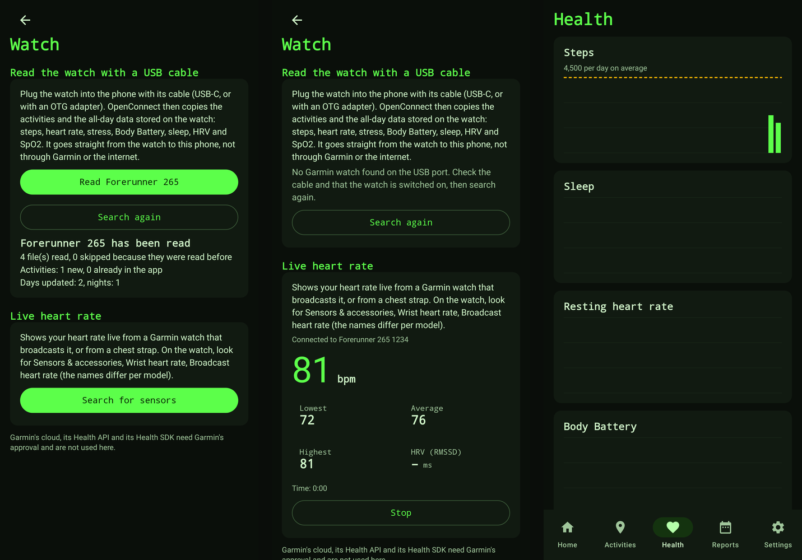

# Reading a Garmin watch directly

Since v0.3.0 the Android app can read a Garmin watch **without a server, without a Garmin Connect account and
without Garmin Connect on the phone**. This page explains what Garmin allows, which routes were looked at,
what was built, how it works in the code, and, just as important, what has **not** been tested on a real watch.



*Rendered by the app's UI tests on a computer, with a **fake** watch ("Forerunner 265") fed with test files from
Garmin's FIT encoder. It is not a capture from a real phone or watch.*

## The short version

| Route | Works without Garmin Connect? | In v0.3.0 | Why |
|-------|------------------------------|-----------|-----|
| **USB cable, watch files (FIT)** | Yes | **Built** | Most Garmin watches show up as a USB storage (MTP) device with a `GARMIN` folder full of FIT files. Those files hold everything the watch records. |
| **Bluetooth heart rate profile** | Yes | **Built** | Watches that can broadcast heart rate (and chest straps) speak the standard Bluetooth Heart Rate Service. Live heart rate and beat-to-beat intervals. |
| Garmin Health SDK (Standard / Companion) | Yes | Not possible | Only for approved enterprise partners: request form, licence, minimum device order. Not available to a hobby project. |
| Android Health Connect | No (it needs Garmin Connect to write into it) | Not built | Garmin Connect can write steps, sleep, heart rate and activities into Health Connect, but that needs the Garmin Connect app and account, has no Body Battery or stress, and is not real time. Worth adding later as an *extra* source. |
| Garmin's own Bluetooth protocol (what Gadgetbridge does) | Yes | Not built | It is reverse engineered, differs per watch model, and Gadgetbridge is AGPL-3.0, which cannot be copied into this MIT project. Writing a second reverse-engineered implementation blind, with no watch to test on, would be irresponsible. |
| Garmin Personal API / Health API | No (cloud) | Not built | Needs Garmin's approval and an API key; see [ANDROID.md](ANDROID.md#garmin). |

**What this means for you:** plug the watch into the phone with a USB cable (the phone must support USB
OTG / host mode), open the *Watch* screen in the app, and press *Sync*. For live heart rate, no cable is needed.

## What can be read

From the FIT files in the watch's `GARMIN` folder:

| Data | Folder | How it ends up in the app |
|------|--------|---------------------------|
| Activities (runs, rides, walks, ...) | `Activity` | Imported like any FIT file: route, heart rate, splits, reports. Marked as coming from the watch. |
| Steps, distance, calories, floors climbed, intensity minutes | `Monitor` | Daily totals |
| Heart rate through the day, resting heart rate | `Monitor`, `HSA` | Daily resting heart rate and the heart-rate samples |
| Stress, Body Battery | `Monitor`, `HSA` | Daily averages and the samples |
| Blood oxygen (SpO2), respiration | `Monitor`, `HSA` | Daily average and minimum SpO2, daily average breathing rate |
| Heart rate variability (HRV) | `Sleep` | Daily overnight HRV |
| Sleep stages (deep, light, REM, awake) and sleep score | `Sleep` | One sleep entry per night |

Not read yet: the `Metrics` folder (VO2 max, training status, recovery time), `Settings`, `Workouts` and
`Courses`. Achievements and badges are not stored on the watch in a form we can use.

## How it works in the code

```
android/core/.../core/watch/        pure Kotlin, tested on the JVM
  FitReader (formats/)              generic FIT reader: field values, arrays, 16-bit timestamps
  WatchFit                          one monitoring/sleep/HSA file  ->  readings + a sleep summary
  Metrics                           Metric enum, MetricSample, DailyAggregator (readings -> day summary)
  WatchSync                         the sync: list files, skip known ones, read, store, recalculate days
  MtpWatchSource                    finds the GARMIN folder on an MTP device and lists the FIT files
  HeartRate                         parser for the Bluetooth Heart Rate Measurement + HRV (RMSSD)

android/app/.../watch/              the Android parts
  UsbWatchLink                      UsbManager permission + android.mtp.MtpDevice behind the MtpTransport interface
  BleHeartRateLink                  BluetoothLeScanner + GATT, Heart Rate Service 0x180D / characteristic 0x2A37
  WatchController                   the state the Watch screen shows (connect, sync progress, live heart rate)
```

### 1. Finding the files (`MtpWatchSource`)

Android exposes a plugged-in MTP device through `android.mtp.MtpDevice`. The app wraps it in a tiny
`MtpTransport` interface (storage ids, children of a folder, read an object), so the folder logic can be
tested without USB. It looks for a folder called `GARMIN` at the top of each storage, or one level down (some
watches wrap everything in a `Primary` volume), and lists the `.fit` files in `Activity`, `Monitor`, `Sleep`
and `HSA`.

### 2. Reading a file (`FitReader` and `WatchFit`)

`FitReader` is a small generic FIT decoder: it checks the signature and both CRCs, handles big and little
endian definitions, skips developer fields, reads array fields and understands "invalid" markers. It hands each
message to `WatchFit`, which keeps only the messages that matter.

Three details of Garmin's wellness files needed care, and each has its own test:

- **Counters are cumulative.** Steps, distance, active calories, ascent and intensity minutes in a `monitoring`
  message count up from midnight (watch time). The value for a day is therefore the largest value of the day, per
  activity type (walking and running are separate counters), not the sum of the messages.
- **16-bit timestamps.** Many monitoring messages carry only the low 16 bits of the time (`timestamp_16`). The
  full time is rebuilt from the previous full timestamp: `ts = last + ((low - (last and 0xFFFF)) and 0xFFFF)`.
  A fixture that rolls over the 16-bit boundary guards this (a deliberate mutation of that line makes the
  test fail).
- **Time zones.** The watch writes its UTC offset in a `monitoring_info` message, and the calendar day of a reading
  is the day on the *watch's* clock. Files without that message use the phone's zone.

Readings are stored per `(metric, time)`, so reading the same file twice cannot double anything.

### 3. Syncing (`WatchSyncService`)

The sync lists the files, reads the small wellness files first (so an interrupted sync still has the days), and
imports activities last. A file is skipped when its size equals the size at the last complete read, and a file
that fails is reported and retried next time. After reading, the daily summary of every touched day is
**recalculated from all readings of that day** (`DailyAggregator`) and merged with what was already there, so the
order and number of syncs do not matter and fields the watch did not report keep their old values.
Sleep for a night is replaced only by a file that is at least as complete as the stored one.

### 4. Live heart rate (`HeartRate`, `BleHeartRateLink`)

The standard Heart Rate Measurement characteristic is decoded exactly as the Bluetooth specification describes:
flag bit 0 selects 8 or 16 bit heart rate, bits 1 and 2 report sensor contact, bit 3 an energy field to skip, and
bit 4 a list of RR intervals in 1/1024 second. From the RR intervals the app computes HRV as **RMSSD**, ignoring
intervals outside 300 to 2000 ms (artefacts). A live session can be saved as an activity.

On many Garmin watches the broadcast has to be switched on first (in the watch's settings, "Broadcast Heart Rate"
or similar, the exact name depends on the model), because the watch only advertises the heart rate service while it
is on.

## Permissions

| Permission | Why |
|------------|-----|
| `BLUETOOTH_SCAN` (flagged *never for location*) and `BLUETOOTH_CONNECT` | Find and connect to a heart rate sensor (Android 12 and newer) |
| `BLUETOOTH`, `BLUETOOTH_ADMIN`, `ACCESS_FINE_LOCATION`, `ACCESS_COARSE_LOCATION` (Android 11 and older only) | Older versions only allow scanning together with the location permission. Nothing uses your location. |
| USB device permission (asked by Android when you plug the watch in) | Read the watch's files |

`INTERNET` is still only used for the optional Claude report. The USB and Bluetooth features declare
`required="false"`, so the app also installs on phones without them.

## Honest limits: what is and is not tested

**Tested automatically (109 core tests, 36 app tests):**

- Decoding of monitoring, sleep and all-day-health FIT files, including 16-bit time rollover, midnight
  boundaries, invalid values and corrupt files. The fixtures were **written by Garmin's own FIT SDK encoder**,
  so they are files our code did not make. The generator is committed
  (`android/core/src/test/fixture-generator/WatchFixtures.java`, instructions in its header); the SDK itself is
  not copied into this repository.
- Daily aggregation, the sync (skipping, retrying, cancelling, merging with existing data), the MTP folder logic and
  the heart rate parser, including HRV.
- The *Watch* screen on the JVM with a fake USB link and a fake Bluetooth sensor, and the database upgrade from
  v0.2.0 to v0.3.0.

**Not tested, because it needs a physical phone and watch:**

- The USB permission flow and `MtpDevice` itself. The app uses `-1` as the root handle when listing a storage, as
  Android's documentation describes, but phone makers differ and this has not run on a device.
- The Bluetooth scan and GATT connection to a real watch or chest strap.
- Whether **real** Garmin files match the assumptions above. They follow the FIT profile (SDK 21.221.0), but they
  have only been checked against synthetic files made with the official encoder. Models differ in which folders
  they fill and which messages they write.
- Garmin's own behaviour: Garmin does not officially support a phone as the USB host, and syncing the watch with
  Garmin Connect can *delete* the Monitor, Sleep and HRV files from the watch once they were uploaded. If you also
  use Garmin Connect, sync with OpenConnect first, or accept that older days are no longer on the watch.

If something looks wrong on your watch, the sync report on the Watch screen shows how many files could not be read
and the first few reasons.

## Regenerating the test files

```
cd android/core/src/test/fixture-generator
# see the comment at the top of WatchFixtures.java: download the Garmin FIT SDK jar, compile, run
```

The generator also decodes each file with Garmin's reader to make sure the fixture is valid before it is written.
Garmin's FIT SDK is distributed under its own licence; that is why it is used only to produce fixtures and is not
shipped in the app.

## Sources

- Garmin FIT SDK and profile: <https://developer.garmin.com/fit/overview/>
- Garmin Health SDK (partner programme, licence): <https://developer.garmin.com/health-sdk/overview/>
- Garmin Connect Developer Program: <https://developer.garmin.com/gc-developer-program/overview/>
- Android `MtpDevice`: <https://developer.android.com/reference/android/mtp/MtpDevice>
- Android Health Connect: <https://developer.android.com/health-and-fitness/guides/health-connect>
- Bluetooth Heart Rate Service (GATT, 0x180D): <https://www.bluetooth.com/specifications/specs/heart-rate-service-1-0/>
- Gadgetbridge (reverse-engineered Garmin Bluetooth support, AGPL-3.0): <https://codeberg.org/Freeyourgadget/Gadgetbridge>

## Where this can go next

Health Connect as an extra source (for watches or apps that do not expose files), the `Metrics` folder for VO2 max
and training status, an export for people who already run Gadgetbridge, and, once Garmin approves a key, the
Personal API for data that never touches the phone.
